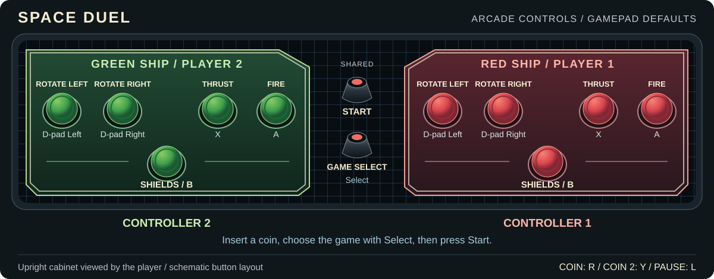

# Space Duel (Arcade, 1982) for MiSTer FPGA

An FPGA implementation of Atari's color-vector arcade game **Space Duel** for
the [MiSTer FPGA](https://github.com/MiSTer-devel/Main_MiSTer/wiki) platform.

In *Space Duel*, the rocks of *Asteroids* give way to glowing spinners and
tumbling cubes that split apart under fire. The best reason to bring a second
pilot is the space station. A fuse links the red and green ships, and a tap of
thrust can swing your partner clear of a spinner or straight into it. Lose one
ship and the fuse burns down to the other.

In separate fighters you can earn 500 points for shooting your partner, who
reappears with fresh shields. Solo pilots can fly either a fighter or the
linked station.

## Support the Project

Hey, Videodr0me here! If you enjoy the core, please support this work and
future updates:
[](https://buymeacoffee.com/Videodr0me)

---

## Original Hardware

| Subsystem | Original Hardware | FPGA Implementation |
|---|---|---|
| **Main CPU** | MOS Technology 6502A at 1.512 MHz | T65 6502 implementation running at 1.512 MHz from the 12.096 MHz master clock |
| **Vector Generator** | Atari Analog Vector Generator with vector RAM/ROM, state PROM, DACs, and analog integrators | PROM-driven AVG preserving the original RGB color selection and four-bit intensity |
| **Audio** | Two Atari POKEYs | Two POKEY implementations running at 1.512 MHz, with selectable PCB audio filtering |
| **Persistent Storage** | 64-byte Atari ER2055 EAROM | ER2055-compatible storage with MiSTer NVRAM persistence |
| **Display** | Wells-Gardner 6100 color XY vector monitor | High-resolution vector framebuffer with bloom, halo, brightness controls, and phosphor decay |
| **Controls** | Independent rotate, fire, shield, and thrust controls for both players | Two MiSTer controllers, keyboard, and cabinet inputs |

The renderer uses the game's native red, green and blue vector signals and
draw timing to reproduce its colors and phosphor trails.

---

## Renderer Features

- **HD vectors:** 1080p and 720p rendering, with optional 120 Hz at 720p.
- **CRT effects:** Bloom, halo, phosphor trails, color space controls, dwell dot scaling, brightness and slot mask.
- **Video profiles:** Five ready-to-use looks and two independent custom slots.
- **Halo reconstruction:** Selectable cubic interpolation with 16x16 or 8x8 cells.
- **CRT output:** 240p, 480i and 480p, including Direct Video and picture positioning.
- **Geometry and timing:** Eight rotation/mirroring combinations, normal or wide
  framing, and optional authentic 61.52 Hz output.

---

## Controls

The original upright cabinet has two sets of five buttons: rotate left,
rotate right, thrust, fire and shields. The green controls on the left operate
Player 2's ship; the red controls on the right operate Player 1's ship.
Start and Game Select are shared controls in the center.



These are the supplied gamepad defaults. Directions and buttons can be
reassigned through MiSTer's input mapping menu. Keyboard controls use MiSTer's
keyboard-to-joystick mapping.

| Input | Function |
|---|---|
| **Left / Right** | Rotate the ship |
| **Fire (Button A)** | Fire |
| **Shield (Button B)** | Activate the shield |
| **Thrust (Button X)** | Apply thrust |
| **Start** | Start the selected game |
| **Select** | Change the game selection |
| **Coin (R) / Coin 2 (Y)** | Operate the two coin inputs |
| **Pause (L)** | Pause or resume the game |

Controller 1 flies the red ship and controller 2 flies the green ship. Either
controller can select and start a game. Insert the required credits, press
**Select** at least once to choose a mode, then press **Start**.
[Atari's operating manual, pp. 1-12 and 1-13](https://arcarc.xmission.com/PDF_Arcade_Atari_Kee/Space_Duel/Space_Duel_TM-181_2nd_Printing.pdf)

### Profile Shortcuts

With the OSD closed, use the two keys immediately to the right of **0** to cycle
profiles. On a US keyboard, **-** selects the previous profile and **=/+**
selects the next. Cycling follows the profile table below, wrapping from
**Custom 2** back to **A Touch of CRT**.

Press **F6** or **Ctrl+Shift+1** to copy the current profile to **Custom 1**.
Use **F7** or **Ctrl+Shift+2** for **Custom 2**. A message confirms the copy.
To edit it, select that custom slot. Use MiSTer's **Save Settings** to keep
your changes.

### Cabinet Diagnostics and Game Saving

**Service Mode** and **Diagnostic Step** are available on the MRA DIP-switch
page, together with the original game and coinage options.

Space Duel stores the top score and its initials for each of the four game
modes in EAROM. Launching a supplied MRA restores that data automatically.
**Autosave NVRAM** defaults to On. To save manually, choose **Save NVRAM**
under **System**. Each MRA has its own `.nvm` file in
`/media/fat/config/nvram/`. MiSTer's **Save Settings** stores OSD
preferences separately.

---

## Requirements and Installation

- DE10-Nano MiSTer with a **32 MB or larger SDRAM module**.
- Game ROMs matching the parts and checksums in the selected MRA.
  **Game ROMs are not included.**

All three game revisions use the same core binary. You can also
[build it from source](#compilation).

1. Copy [Arcade-SpaceDuel_20261123.rbf](releases/Arcade-SpaceDuel_20261123.rbf)
   to `_Arcade/cores/`.
2. Copy [`Space Duel (Rev 2).mra`](releases/Space%20Duel%20%28Rev%202%29.mra)
   to `_Arcade/`.
3. Place `spacduel.zip` in `games/mame/`, then launch the MRA.

Rev 1 and Prototype MRAs are in
[`releases/_alternatives/_Space Duel`](releases/_alternatives/_Space%20Duel/).
To add Rev 1 or the prototype, copy the `_alternatives` folder from
`releases/` into `_Arcade/`, keeping its directory structure.
The Rev 1 MRA names `spacduel1.zip` and the Prototype MRA names
`spacduel0.zip`. Both also accept the matching parts from a merged
`spacduel.zip`. Put the archives in `games/mame/`. Launching through the MRA
configures the program ROMs, AVG state PROM, controls, DIP switches and EAROM
persistence.

---

## Recommended MiSTer Video Settings

**1080p** gives the highest vector detail. Compatible 720p displays can also
use the optional 120 Hz mode. The core also supports 480p, 480i and 240p.

The game runs at its original hardware timing in every video mode. Enable
**61.52Hz (Authentic)** to match video output to its nominal 61.5234375 Hz update
cadence, or leave it Off for the more widely compatible 60 Hz presentation.
HDMI users normally need `vsync_adjust=1` or `2` for the authentic and 120 Hz
modes.

For high-resolution flat-panel output, place these settings under the exact
`[Space Duel]` header at the end of `MiSTer.ini`:

```ini
[Space Duel]
direct_video=0
video_mode=8   ; 8 = 1080p, 0 = 720p
video_mode_ntsc=
video_mode_pal=
hdr=1
vsync_adjust=1
vscale_mode=0
vfilter_default=
vfilter_vertical_default=
vfilter_scanlines_default=
vfilter_interlace_default=
shmask_default=
shmask_mode_default=0
```

These entries leave MiSTer's default filters and shadow mask off. If you
previously saved video processing settings for Space Duel, open MiSTer's
**Video Processing** menu and turn off any extra filters or shadow mask there.
Use `hdr=0` if your display does not support HDR.

For an external HDMI scaler that accepts 1080p, use `direct_video=0` and
`video_mode=8` to retain the highest vector detail. Direct Video renders at
240p, 480i or 480p; subsequent upscaling cannot recover the detail available
from native 1080p rendering.

### CRT and Direct Video Output

For a **15 kHz CRT**, use these video settings in the same section instead:

```ini
[Space Duel]
video_mode=720,240,60
vsync_adjust=0
video_mode_ntsc=
video_mode_pal=
vga_scaler=0
forced_scandoubler=0
```

Under **Video Timing & Geometry**, **15 kHz Format** selects 480i or 240p, with
480i used by default. Keep the VGA scaler and forced scandoubler disabled for
native CRT output. For a 31 kHz CRT, use `video_mode=720,480,60` instead.

For Direct Video, add `direct_video=1` to the same settings. Use **Direct
Video Scan Rate** to select 15 kHz or 31 kHz. At 15 kHz, choose **480i** or
**240p** under **15 kHz Format**.

On a real CRT, start with **A Touch of CRT** or a **Custom** profile. Reduce
bloom, halo and slot mask to suit the effects already produced by the display.

---

## Video Options

### Video Profiles & Effects

| Profile | Description |
|---|---|
| **A Touch of CRT** | Subtle halo and bloom while vectors remain crisp. |
| **80s Cruise Control** | The default arcade look. The 720p and 1080p presets add WG6100 color and a mild slot mask. |
| **80s Overdrive** | Hotter vectors, stronger bloom, and longer trails. |
| **Neon Fever** | Cubes tumble in gently flickering neon light. Shoot one and its fragments leave trails of color. |
| **Plasma Storm** | Explosions cast broad halos and leave bright trails. **Epilepsy warning &mdash; intense flashing and bright lights.** |
| **Custom 1** | Custom settings initialized from Cruise Control for the current resolution. |
| **Custom 2** | Custom settings initialized from Overdrive for the current resolution. |

Fixed profiles adapt to the output resolution. Both Custom slots retain their
own settings through later resolution and profile changes. Saved custom
settings take precedence over the initial defaults; use MiSTer's
**Save Settings** to retain your choices.

Select **Custom 1** or **Custom 2** to adjust these controls:

| Control | Description |
|---|---|
| **Dot Scale** | Sets the size of stationary beam dots. Choose 1x, 1.5x, 2x, 2.5x, 3x, 4x or 5x. |
| **Brightness** | Adjusts how the game's intensity levels become on-screen brightness. |
| **Bloom Width / Curve** | Controls the width of local glow and how strongly bright vectors produce it. |
| **Halo / Curve / Spread** | Controls the strength, brightness response and spatial distribution of the broader glow. |
| **Halo Compression** | Compresses bright halo highlights. |
| **Halo Grid** | Selects 16x16 or 8x8 cells for cubic halo reconstruction. |
| **Inter-Frame Decay** | Sets how long light from earlier vector frames takes to fade. |
| **Intra-Frame Decay** | Varies brightness according to when each pixel was drawn within its frame. |
| **Color Channels** | Selects RGB channel permutations, black and white, or negative colors. |

**Slot Mask** simulates a color vector CRT's mask and rotates with the picture.
Choose **Off**, **Mild**, **Medium** or **Max**.

Under **Color Space**, choose **WG6100->709** to approximate the colors of the
Wells-Gardner 19K6100 on a modern display.

### Video Timing & Geometry

| Option | Description |
|---|---|
| **Orientation** | Provides all eight rotation and mirroring combinations. |
| **Zoom** | Selects normal framing or a wider view. |
| **120Hz (720p only)** | Enables 120 Hz output on compatible 720p displays. |
| **61.52Hz (Authentic)** | Matches the original game's nominal frame cadence. |
| **Direct Video Scan Rate** | Selects 15 kHz or 31 kHz when Direct Video is active. |
| **15 kHz Format** | Selects 480i or 240p at 15 kHz. |
| **CRT Vertical Position** | Moves low-resolution CRT output vertically. |
| **CRT Horizontal Position** | Moves low-resolution CRT output horizontally. |
| **Aspect Ratio** | Optimized (default) uses the core's intended presentation and is recommended. Stretched fills the display; Pixel Perfect requests direct pixel mapping. |

### System

**Pause when OSD is open** defaults to Off. **Dim video after 60s** defaults to
On and dims the picture while paused. Pausing also mutes the game audio.
For high-score saving, see
[Cabinet Diagnostics and Game Saving](#cabinet-diagnostics-and-game-saving).

**PCB Audio Filter** defaults to On and models the game PCB's analog sound
filtering before the external amplifier. Select **Off** to hear the unfiltered
mix from the two POKEYs.

#### Diagnostics

The controls under the **Diagnostics** heading on the **System** page are
intended only for diagnostic use. Leave them at their defaults for normal play.

---

## Compilation

Open `Arcade-SpaceDuel.qpf` in **Quartus Prime Lite 17.0** and run the full
compilation. Quartus writes `Arcade-SpaceDuel.rbf` to `output_files/`.

## Credits and Acknowledgments

### The original arcade game

- **Atari, Inc.** released *Space Duel* in 1982. **Richard "Rick" Maurer**
  began the game. **Owen Rubin** completed it, designing the spinning targets
  and adding the bonus waves. [Owen Rubin on Space Duel](https://atarimuseum.ctrl-alt-rees.com/orubin/spaceduel.html)
  and [his Retro Gamer interview, p. 77](https://electronicsandbooks.com/edt/manual/Magazine/R/Retro%20Gamer%20UK/32.pdf#page=77)
- **Dean Chang** designed the chip that held the original vector generator's
  program counter and return stack. [Jed Margolin's account of Atari's vector hardware](https://jmargolin.com/vgens/vgens.htm)
- **Dave Theurer** wrote the high-score memory routines adapted for the game.
  **Brian McGhie** wrote the diagnostic program for the color vector board.
  [Atari's original assembly listings](https://github.com/historicalsource/space-duel)

### The MiSTer core

- **Videodr0me** implemented the Space Duel arcade board and its PROM-driven
  vector sequencer for MiSTer, and developed the native-color framebuffer,
  video timing and geometry, CRT effects and PCB audio filter.
- **Jeroen Domburg** wrote the original FPGA vector drawer and 2 KB vector RAM
  adapted for this core. [Black Widow in an FPGA](https://spritesmods.com/?art=bwidow_fpga)
- **Daniel Wallner, Mike Johnson, Wolfgang Scherr and Morten Leikvoll** are
  credited in the T65 implementation of the 6502. **Mike Johnson (MikeJ)**
  also wrote the FPGAArcade POKEY model used for both sound chips.
  [T65 source](rtl/t65/T65.vhd) and [POKEY source](rtl/pokey.vhd)
- **Jim Gregory (JimmyStones)** wrote the pause module. **Alexey Melnikov
  (Sorgelig)** and the **MiSTer community** developed the platform.
  [Pause_MiSTer](https://github.com/JimmyStones/Pause_MiSTer) and [MiSTer FPGA](https://github.com/MiSTer-devel/Main_MiSTer)

Thanks to the **MAME contributors** for their arcade hardware research, and to
the **Historical Source** archive for preserving Atari's assembly listings.

## License

This project is distributed under the GNU General Public License, version 3 or
later. Third-party components retain the copyright and license notices in
their source headers. See [LICENSE](LICENSE) for the project license.
